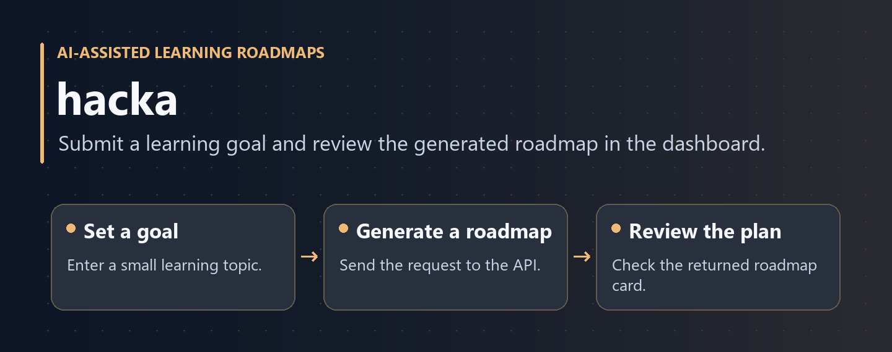

# hacka

**Tech stack** · React · Vite · Node.js · Express · MongoDB · Google Generative AI SDK

Submit a learning goal and review the generated roadmap in the dashboard.

## What it does

- **Set a goal** · Enter a small learning topic.
- **Generate a roadmap** · Send the request to the API.
- **Review the plan** · Check the returned roadmap card.

## Getting started

1. Run `npm ci` in `backend/` and `frontend/`.
2. Set up your own local development configuration and API credentials. See the tracked-file finding in the review before republishing this project.
3. Run `npm start` in `backend/` and `npm run dev` in `frontend/`.

## Source layout

| Path | Purpose |
| --- | --- |
| `frontend/` | React form, dashboard, and roadmap cards. |
| `backend/routes/roadmaps.js` | Server routes for the roadmap workflow. |
| `backend/package.json` | Server dependencies and scripts. |

## Tests and verification

- Inside `frontend/`, run `npm run lint` and `npm run build`. The backend `test` script is a placeholder.
- Use a non-sensitive sample to check a successful client request.
- Verify that absent development configuration produces a clear failure without exposing credential values.

The upstream source has no working automated test suite detected.

## Credits and license

ISC is declared in `backend/package.json`. Confirm the permission and notices for the full repository and its assets before standalone redistribution.

[Original repository](https://github.com/Pradeep-Polishetty/hacka) · `Pradeep-Polishetty` and upstream contributors
